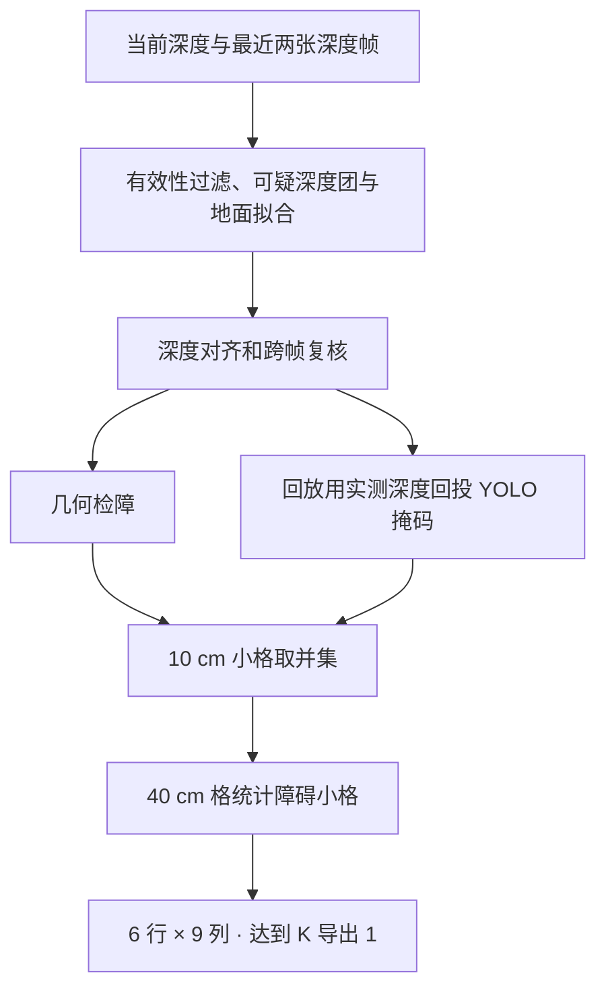

# CS30 融合点阵 2.0

2.0 使用独立包名 `com.lingtouch.cs30fusion`。实时深度入口使用 USB 原生 640×480 uint16 毫米帧和相机内参。RGB-D 回放读取同一采集目录、同一编号的 960×540 RGB PNG 与配准 RAW，在手机 CPU 上运行 YOLOv8s-seg。[安装使用](android_usage.md)

自动模式每约 500 ms 选一张完整帧。深度流按至少 160 ms 的间隔留两张近期帧作历史证据。后台算完复核、投影和栅格后才发布结果，界面在这之前显示上一张点阵。手动模式处理下一张完整帧。拔线或断开时清理对应 USB 会话。

深度检查标记被无效测量包围的近距团块。姿态对齐通过双向深度检查，并有足够视点位移时，才用历史帧确认或否定可疑测量。遮挡、缺测及配准不可靠的区域保留未知。15 cm–1.90 m 高度带内每个 10 cm 小格至少 4 个有效点才作几何障碍。回放使用同一份复核深度，YOLO 掩码里的测量经实例深度一致性检查后补入同一套小格。

点阵左右范围 ±1.8 m，前方 1.0–3.4 m。输出上远下近、从左到右。每个 40 cm 格含 16 个小格，默认 K=3。0/1 JSON 只表达是否达到 K，未知仍在诊断计数中。缺可信地面时停用导出。

回放从目录名的 `YYYYMMDDHHMMSS` 读取时间，选择当前帧前 2.2 秒内至多两个时间不同的深度文件。配对文件沿用本机 CS30 样本的近似 RGB 内参与光轴 Z 假设。实时入口沿用 1.7 的 USB 原生深度格式。真实手机上的接线、重插和处理时延需现场验收。[验证记录](validation.md)
