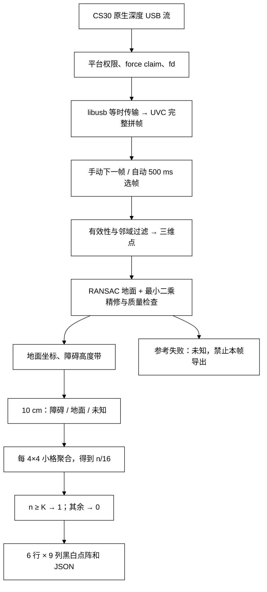

# 1.x 深度 pipeline 与数据契约

当前版本见 [2.0 深度复核与融合](fusion_2_0.md)。

## 输入与坐标

| 输入 | 格式 | 处理入口 |
|---|---|---|
| 当前原生深度流 | 640×480、uint16 小端、毫米；完整帧 614,400 字节 | `Cs30LibusbSource → Engine`，内存处理，不要求落盘 |
| 历史 RGB-D 文件 | 同帧 960×540 RGB PNG + 对齐深度 RAW，1,036,800 字节 | 可选离线原型；其 RGB 内参/假设与原生深度不同 |

本项目输入的是 ASIC 已计算的深度，不是等待相位解算的 ToF 相位 RAW。`.raw` 文件后缀本身不足以确定数据含义。两种格式不可通过缩放互换。

原生相机内参在启动时按设备读取，来源 ID 随结果保留；标定 blob 字段解读和光轴 Z/去畸变假设仍应以实物平面核验。相机坐标为 x 右、y 下、z 前；地面坐标为 x 右、y 前、z 上，原点是相机在地面的垂直投影。

## 几何规则

参数唯一来源为 `vision/core/config/lingtouch_defaults.conf`。

| 阶段 | 当前取值 |
|---|---|
| 有效深度 | 100–5000 mm，0/1 无效 |
| 飞点支持 | 3×3 至少 1 个一致邻居；容差 max(50 mm, 5%×中心深度) |
| 疑似绕回 | 半径 3、无效比例 0.7、近点上限 1500 mm；需继续检查误删小结构 |
| 地面 | 步长 4；200 次 RANSAC；内点距离 3 cm；至少 500 内点；最小前向跨度 0.6 m |
| 质量 | 相机高度 0.4–2.2 m、倾角≤75°；平面下超过 10 cm 的点占比≤5% |
| 地面支持 | 距拟合平面不超过 ±5 cm |
| 障碍支持 | 离地 0.10–1.90 m 的有效测量 |

障碍判定不依赖物体类别。去噪在测量阶段完成，不使用小物体面积阈值把细杆或椅腿当噪声删除；单帧仍可能无法区分有内部一致性的多径伪影与真实小表面。

## 细格、粗格与输出

范围：x∈[-1.8,1.8) m，前方 y∈[1.0,3.4) m。细格 36 列×24 行，每格 10 cm；粗格 9 列×6 行，每格 40 cm。内部细格保存顺序为近到远；公开粗格输出第 0 行最远、第 5 行最近。

细格只要有有效障碍支持就为障碍；没有障碍且看见地面才为地面；其余未知。障碍优先。每个粗格保存障碍、地面、未知三个小格数，三者之和为 16。同小格 1000 个点仍只贡献 1。

K 默认 3、范围 1–16，`n≥K` 导出 1，否则 0。K 是显示门槛，不是去噪强度；阈下小障碍仍在证据中。0 也包含未知，不能直接解释为确认空闲。

JSON 是 **6 个数组，每个 9 个整数**，上远下近、左至右，参见 [格式样例](validation/matrix-example.json)。地面参考失败时禁止导出本帧；停止、切换模式和断线保留业务端最后快照及帧号/时间。保存前冻结当前快照与 K，避免系统保存页期间被新帧替换。

注意两套内部编码不同：旧 `CellState` 为 0=free、1=occupied、2=unknown；新增 `SubcellEvidence.fine` 为 0=unknown、1=obstacle、2=ground。对接新点阵应使用 `obstacle[54]` 计数，不直接发送细格编码。

## 后续 RGB 辅助的位置

先取得同步 RGB 和可靠配准，再把地面掩码关联到原生深度点，辅助选地面候选；仍由全部有效深度测量决定障碍。YOLO 可用于实例关联，SAM 不是默认环节。RGB 掩码不补造深度、不清除实测障碍。可选代码见 `lab/rgbd_offline`；它尚未接入实时 APK。
